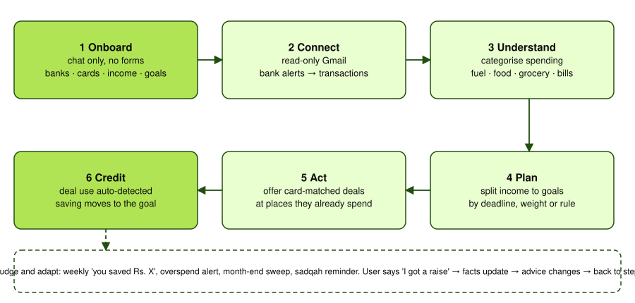
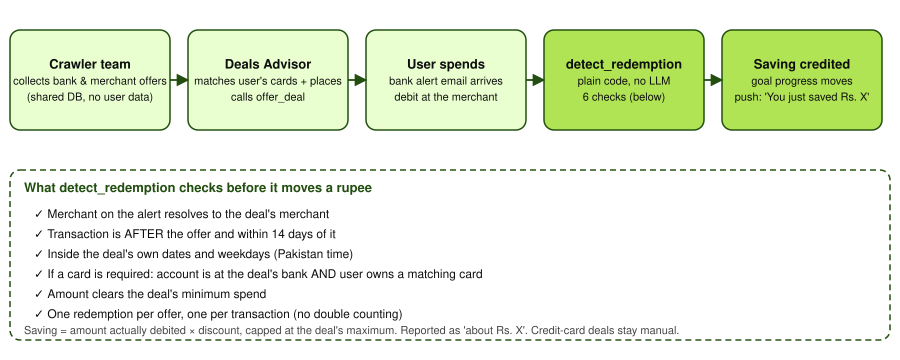
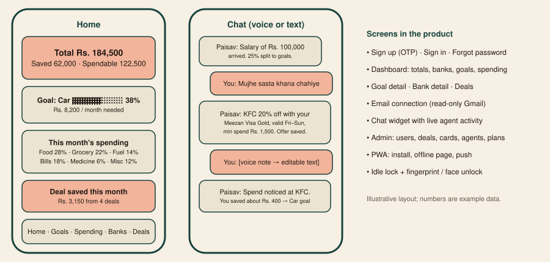
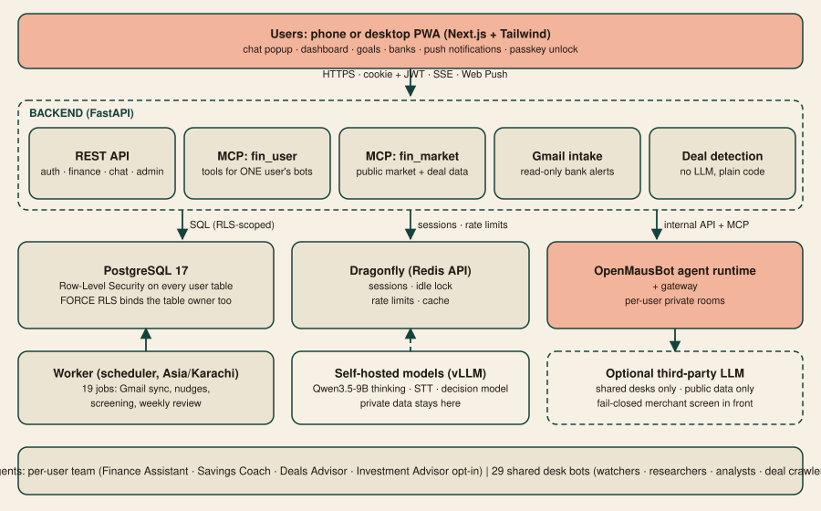
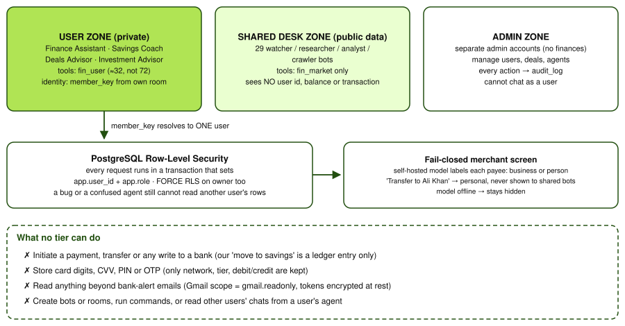

# 1. Summary

**Paisave** is an AI agent that acts as a personal finance assistant for people in Pakistan. A user talks to it, in English or Roman Urdu and by text or voice. It learns their banks, cards, income and saving goals through conversation. It then reads their bank-alert emails and turns them into categorised spending. It works out how much they can save, finds the card discounts they can use at the places they actually spend, and credits every discount they use to a saving goal. It messages them first when something matters, including when the app is closed.

**Track and topic.** International Track, **Topic A: Personal Finance Assistant** ("smart budgeting, bill analysis, spending insights, actionable recommendations based on the user's income and expenses").

**Design position.** The agent is a financial *participant* that decides and acts inside the user's ledger: it creates goals, splits income between them, records transactions, offers deals and closes the loop when a deal is used. It has **no authority over real money**. It cannot initiate payments or transfers, and it holds read-only access to email. We chose this deliberately: the safest permission tier for a consumer finance agent is one where the worst possible mistake is a wrong number on a screen, not a wrong payment.

**Team ACE 2.0.** Muhammad Osama Khan (Team Leader): architecture and all technical work. Ayesha Taimur (QA and Project Manager): test planning, quality assurance, delivery and submission. Both are students in Pakistan.

# 2. Problem and target user

Most Pakistani salaried users hold several accounts (a bank, a mobile wallet, a digital bank) and several cards. They have no single view of their money. The bank sends an SMS or email for every transaction, but nothing turns those alerts into a budget. Card discounts are plentiful (banks run hundreds of merchant promotions) but are scattered across bank websites and social pages, tied to a specific card network and tier, and expire quickly. People miss them and never see the savings.

Existing budgeting apps assume a US-style open-banking API, manual entry, or a form-heavy setup. None of those fit a market where bank data arrives as email alerts and where the card and tier you hold decide which discount applies.

Our user is a salaried or self-employed person with a phone as the main device, who wants to save toward concrete goals ("a car in 6 months on Rs. 100,000 a month") without becoming a spreadsheet user.

## 2.1 Why Pakistan, and why it is a commercial opportunity

We chose Pakistan on purpose. It is a large market where the standard fintech assumptions fail, which is exactly where an AI agent has to do real work instead of calling a clean API.

- **Digital money is arriving fast, but unevenly.** Karandaaz's 2024 survey puts access to digital financial services at 35% of adults, up from 7% in 2014, and the central bank targets 75% account ownership by 2028 (sources [1], [2]). Sources disagree on exact account-ownership figures because of different definitions, so we quote them as direction, not as a precise market size.
- **Instant payments are mainstream.** Raast, the national instant-payment rail, processed 496 million transactions in FY2024, up from 147 million in FY2023 [3]. Users now move money constantly but have no tool that explains where it goes.
- **Remittances put money in family hands.** Pakistan received a record $38.3 billion in remittances in FY2025 [4]. Households that receive and then divide this money for rent, school fees and goals are a natural user group.
- **Phones are the channel.** About 116 million people were online in early 2025 [5].
- **There is no open-banking layer to build on.** What every bank does send, reliably, is a transaction alert by email or SMS. Using that as the data source makes the product work today, with no bank partnership needed for version one.
- **Discounts are everywhere but unusable.** Banks run card-specific merchant promotions, scattered across websites and social pages. Nobody matches them to the card in your wallet.
- **Local fit that global apps do not have.** Roman Urdu and voice, Islamic-finance awareness (riba-free options, sadqah), PSX and gold as normal savings vehicles, and a catalogue of local banks, wallets and cards.

**Is a single-country focus a weakness?** We treat it as a *beachhead with a repeatable playbook*. The pattern (read alert emails, validate against a local card catalogue, match local offers, credit savings) transfers to other markets where banks notify by email or SMS instead of exposing open APIs. We list that as a hypothesis in the roadmap, not as proven. The honest trade-off is lower revenue per user than in rich markets, which is why the business model (section 8) relies on volume, merchant-funded offers and B2B2C distribution rather than subscriptions alone.

## 2.2 Personas

Illustrative personas, not interview subjects.

| Persona | Situation | What Paisave does for them |
|---|---|---|
| **Hina, 27, salaried in Karachi** | Salary Rs. 100,000, two bank accounts and a wallet, wants a car in 12 months, never budgets. | Turns the salary credit into goal contributions, shows a realistic monthly amount, nudges when a day is overspent. |
| **Bilal, 22, final-year student** | Pocket money and part-time income, Visa debit card, loves eating out. | Finds card-matched food deals and credits each saving to his laptop fund. |
| **Mr. and Mrs. Qureshi, 45, family household** | Rent, school fees, remittance from a relative abroad, prefer riba-free products. | Splits income across fees, emergency fund and Hajj goal; sadqah reminders; Roman Urdu or Urdu chat. |
| **Admin / operator** | Runs the service. | Manages deals, cards, agents and users from a separate admin dashboard with an audit trail. |

# 3. What the agent does (task completion)

| Capability | What happens | Where in the code |
|---|---|---|
| **Chat-based onboarding** | No forms. The Finance Assistant collects banks, the exact card ("Visa Gold debit, Meezan"), income and pay day, goals, savings rule, sadqah preference and optional investing opt-in, one topic per message, in any order. | `ai-ml/prompts/finance_assistant/SOUL.md`, `backend/app/mcp/user_server.py` |
| **Card validation** | Cards are saved only if they exist in a catalogue of 163 real cards across 23 banks and wallets. A near miss returns `did_you_mean` and asks the user to confirm. No card digits, CVV, PIN or OTP are ever stored. | `backend/app/seed/cards.py`, `services/cards.py` |
| **Transaction intake** | Bank-alert emails are read from Gmail (read-only) every 5 minutes. A regex parser handles known bank formats; an LLM parse is the fallback. Users can also tell the chat ("I spent 2,000 at Imtiaz"). | `services/gmail.py`, `services/categorize.py` |
| **Spending insight** | Transactions are categorised (food, grocery, fuel, medicine, utilities and so on). The dashboard shows totals, a per-bank breakdown, expendable vs saved money and a per-goal progress view. | `services/finance.py`, `api/finance.py` |
| **Savings planning** | Savings rule: percentage of income, fixed amount, or whatever is left at month end. Several goals are split equally, by priority, by custom weights or by deadline. A preview shows what each rule means, and the agent says so honestly when a goal is unrealistic. Capped goals redistribute overflow, and the split always conserves money (unit-tested). | `services/finance.py`, `tests/test_finance.py` |
| **Deal discovery and capture** | A crawler team collects bank and merchant offers into a shared database, with validity dates, weekdays, card requirements and caps. A per-user Deals Advisor matches them to the user's cards and favourite places and records an offer with `offer_deal`. | `ai-ml/prompts/deals_*`, `services/deals.py` |
| **Automatic deal-use detection** | When a debit alert arrives, plain code (no LLM) checks it against the deals the person was offered: same merchant, inside the dates and weekdays, matching card, over the minimum spend. A match credits the saving to their goal and sends "Great, you just saved Rs. X". Each offer and each transaction can count only once. | `services/deal_detect.py`, `tests/test_deal_detect.py` |
| **Proactive nudges** | Weekly savings summary (Fri), overspend alert when a day exceeds 1.8x the daily budget, month-end leftover sweep into goals, optional sadqah reminders, a Sunday check-in from the agent. They arrive as push notifications (Web Push) even with the app closed. | `worker.py`, `services/jobs.py`, `services/notify.py` |
| **Memory and adaptation** | "I got an increment", "I closed my card": the agent updates the structured data and stores a fact that supersedes the old one, so later advice changes. | `remember_fact` / `forget_fact` tools |
| **Voice** | Voice notes are transcribed to editable text in English or Roman Urdu (Urdu script on request). | `core/llm.py`, `frontend/src/lib/wav.ts` |
| **Optional investment board** | Opt-in only, behind a disclaimer the user must accept. Five desks (gold and silver, PSX, foreign stocks, crypto, Pakistani real estate) publish signals and research; the per-user Investment Advisor explains them. | `ai-ml/prompts/*_{researcher,analyst,watcher}` |

# 4. System architecture

**Services** (Docker Compose for development, Railway for production, one `Dockerfile` per folder, one root `.env`):

| Service | Role |
|---|---|
| `frontend` | Installable PWA, mobile-first and responsive to desktop. Sign-up, sign-in, password reset, email connection, dashboard, goal detail, bank detail, chat widget. Idle lock and fingerprint / face unlock (WebAuthn passkeys). |
| `backend` | FastAPI API plus the two MCP tool servers and the Alembic migrations. |
| `worker` | The only scheduler. Runs jobs and wakes the agents. Exactly one replica. |
| `omb` | OpenMausBot agent runtime plus the gateway that bridges it to the backend. |
| `postgres`, `dragonfly` | Data, and sessions / rate limits. |

## 4.1 Agent design

- **Teams.** Each user gets a private team of 3 to 4 agents in a private chat room: *Finance Assistant* (lead, onboarding, everyday questions), *Savings Coach* (budget and habits), *Deals Advisor* and, if opted in, *Investment Advisor*. Every agent's behaviour is a Markdown prompt in `ai-ml/prompts/<agent>/SOUL.md`. Agents are created at first start and re-applied only when their prompt hash changes.
- **Decision model.** A small model routes each message to the right advisor, and the Finance Assistant answers by default.
- **Tools, not free text.** Agents change state only by calling typed tools (`create_goal`, `add_card`, `record_transaction`, `move_to_savings`, `offer_deal`, `avail_deal`, ...). The tools validate inputs, enforce business rules (for example the card catalogue) and write the ledger. The LLM never writes SQL or amounts directly.
- **Deterministic core, LLM at the edges.** Money maths (goal splits, savings rules, discount value, redemption matching) is ordinary tested Python. The LLM handles language, onboarding dialogue, parsing unfamiliar alert formats and judging merchants. This keeps the numbers auditable and the failure modes bounded.
- **Shared desks vs private teams.** Public-data desks (market watchers, researchers, deal crawlers) are scheduled, keep their own memory and write to shared tables. Per-user agents have no memory except their own private room. OpenMausBot copies recent activity from a bot's other chats into its prompt, so a shared bot serving several users would leak between them; we therefore clone one private bot set per user rather than share bots.

## 4.2 Data model (summary)

User-owned tables: `users`, `user_profiles`, `bank_accounts`, `cards`, `goals`, `savings_ledger`, `transactions`, `deal_offers`, `deal_redemptions`, `user_facts`, `email_connections`, `chat_rooms`, `chat_messages`, `push_subscriptions`, `webauthn_credentials`, `notifications`. Shared reference tables: `banks`, `card_products`, `categories`, `merchants`, `deals`, `market_signals`, `research_notes`, `watch_clusters`, `plans` (the schema is ready for billing later). System tables: `agent_registry`, `audit_log`.

# 4A. Use cases

Each use case names the actor, the trigger, what the agent does and the measurable outcome. All of them run on the current build.

| # | Use case | Trigger | What happens | Outcome |
|---|---|---|---|---|
| UC1 | **Onboard by conversation** | New user signs up with an emailed OTP | The Finance Assistant asks one topic per message: banks, exact cards, income and pay day, goals, savings rule, sadqah and optional investing. Answers can come in any order and in Roman Urdu; the language is detected, never asked. A card is saved only if it exists in the 163-card catalogue; a near miss returns "Did you mean the Meezan Mastercard Classic Debit Card?" | A complete profile with no forms. Only the card type is stored, never digits. |
| UC2 | **Salary arrives, savings split itself** | Salary credit alert in Gmail, or "salary aa gayi" in chat | The credit is recorded, the savings rule (percentage, fixed amount or leftover) is applied and the amount is divided across goals by deadline, weight or equal split. Capped goals pass overflow on; the total is conserved. | Rs. 25,000 of a Rs. 100,000 salary at a 25% rule lands in the right goals within minutes and the user gets one summary message. |
| UC3 | **"Where did my money go?"** | User asks, or opens the dashboard | Debit alerts are categorised (food, grocery, fuel, medicine, bills, transfers). The Savings Coach explains the month in plain language and flags the biggest category against the budget. | Spending by category and by bank, with one concrete tip. |
| UC4 | **Find and use a discount** | "Mujhe sasta khana chahiye" or a proactive suggestion | The Deals Advisor reads the user's cards and favourite merchants, finds valid deals, explains the conditions (days, minimum spend, cap) and records an offer. Later, a matching debit alert is detected by plain code and the saving is credited to a goal. | A measurable rupee saving per deal, with no manual entry. |
| UC5 | **Life changes, plan adapts** | "I got an increment" / "I closed my HBL card" | The agent updates the structured data and stores a fact that supersedes the old one. Future splits and deal suggestions change. | Advice stays current without re-onboarding. |
| UC6 | **Overspend nudge and weekly review** | Day's spend exceeds 1.8x the daily budget; Friday evening; Sunday check-in | Push notification even with the app closed: a gentle alert, "You saved Rs. X this week", or one tip, one relevant deal and at most one question. | Behaviour change through small, timely messages. |
| UC7 | **Voice note in Roman Urdu** | User taps the mic | Speech is transcribed to editable text in English or Roman Urdu (Urdu script on request), the user fixes any word, then sends. | Usable by people who find typing in Urdu hard. |
| UC8 | **Optional: understand an investment signal** | User opts in after reading a disclaimer | The Investment Advisor explains signals and research from the five desks (gold and silver, PSX, foreign stocks, crypto, real estate) and always repeats the disclaimer. It gives no guarantees. | Plain-language market context, never a trade. |
| UC9 | **Operator keeps the catalogue healthy** | Daily | The admin reviews deals, cards, agents and users; expired or duplicate deals are cleaned automatically; every admin action is logged. | A trustworthy deal and card database. |

## Worked example (UC4, end to end)

1. Hina told the assistant in onboarding that she holds a *Meezan Visa Gold debit card* and spends at *KFC*.
2. The crawler team had saved a deal: *KFC, 20% off, Fri to Sun, minimum Rs. 1,500, maximum discount Rs. 500, Meezan Visa cards*.
3. On Friday the Deals Advisor tells her and calls `offer_deal`; the offer is recorded for her only.
4. She pays Rs. 1,600 at KFC (the bank debits the price after the 20% discount, so the full bill was Rs. 2,000). Her bank emails a debit alert; the Gmail job parses it.
5. `detect_redemption` confirms merchant, date window, weekday, card and minimum spend, then works out the saving from the amount actually debited (Rs. 1,600 ÷ 0.8 = Rs. 2,000 bill, so Rs. 400 saved) and caps it at Rs. 500.
6. The saving is added to her *Car* goal, the offer is closed so it cannot count twice, and she receives "Great, you just saved about Rs. 400."

# 5. Security and compliance (30% of the score)

## 5.1 Permission tiers

| Tier | Who / what | Can do | Cannot do |
|---|---|---|---|
| **T0: public** | Anonymous visitor | Sign up (OTP-verified email), sign in, reset password | Anything else |
| **T1: user** | Signed-in person | Read and write **only their own** rows; chat with their own agents | See any other user; admin pages |
| **T2: user's agents** | The 3 to 4 private bots | Call the `fin_user` tool set (about 32 tools, vs 72 offered by default) with the room's member key | Create bots or rooms, run commands, read other chats, move real money |
| **T3: shared desk agents** | 29 market and deal bots | Call the `fin_market` tool set over public data and shared tables | See any user id, balance or transaction |
| **T4: admin** | Admin accounts (separate from users; they have no finances or chat) | Manage users, deals, agents, plans; every action is written to `audit_log` | Read a user's private chat as a user |
| **T5: system** | Worker and gateway | Background jobs, migrations | Reachable from outside; authenticated with a shared internal key |

**No tier can initiate a payment, transfer or any write to a bank.** The only "move to savings" is a ledger entry in our own database. The only external credential held for a user is a read-only Gmail token.

## 5.2 Controls

- **Row-Level Security in the database, not just the API.** Every user-owned table has `ENABLE` and `FORCE ROW LEVEL SECURITY` with a policy keyed on `app.user_id`. Each request opens a transaction that sets the role and user id (`scoped_session`). A bug in application code, or a tool call from a confused agent, still cannot read another user's rows. We verified this directly in Postgres. Regular users cannot touch global tables (read-only for them); only admin or system roles can write.
- **Agent isolation.** OpenMausBot gives MCP servers no caller identity, so each tool takes a random `member_key` that lives only in that user's private room bulletin and resolves to exactly one user. Keys are stored hashed and encrypted. Calls are rate-limited (600 per minute per key; invalid keys are throttled and delayed).
- **Least-privilege tools per agent.** Allow-lists are set per bot in `ai-ml/gateway/teams.py`.
- **Authentication.** Argon2 password hashing; short-lived JWT access token plus a rotating refresh token held in a server-side session; sign-up needs an emailed OTP; passkeys (fingerprint / face) via WebAuthn.
- **Bank-app-style idle lock.** After inactivity the session is *locked*: the API answers 423 until the user re-enters a password or uses a passkey. Unlock attempts are limited.
- **Browser protections.** Session cookies are `HttpOnly` and `SameSite=Lax`, with `Secure` switched on in production. Every cookie-authenticated write must carry a custom header that cross-site forms cannot send, otherwise the API answers 403.
- **Abuse limits.** Rate limits on sign-up (10 per hour per IP), OTP verify, resend, sign-in (8 per 15 minutes per IP and email), password reset, unlock and tool calls.
- **Data minimisation.** Card numbers, CVV, PIN and OTP are never requested or stored. Only network, tier and debit/credit are kept. A bank account keeps an optional last-4 of the account number, read from alerts so they match the right account. Of each Gmail message we keep only its id and subject, never the body. If a user types digits, the agent tells them not to share and does not store them. Gmail access is `gmail.readonly`, and only bank-alert messages are parsed. Gmail tokens are encrypted at rest (Fernet).
- **Privacy boundary for third-party models.** User chats, advisors and bank-email parsing run only on the **self-hosted** model. The shared desks may be pointed at a third-party LLM because they handle public data only. The one user-derived input they receive is merchant names, and every new merchant is first screened by the self-hosted model so a private payee ("Transfer to Ali Khan") is marked `personal` and never reaches a shared bot. The screening **fails closed**: if the model is offline the merchant stays hidden.
- **Secrets.** One root `.env` (git-ignored). The agents container receives only the 16 variables it needs, so JWT, encryption, SMTP, OAuth and database-owner secrets never reach it.
- **Auditability.** Admin actions are logged. Each deal saving, ledger entry and transaction records its source (`gmail`, `chat`, `deal`).

## 5.3 Compliance and responsible AI

- The agent states that it is **not a licensed financial advisor** and gives no guarantees. The investment board is opt-in; the user must see and explicitly accept the disclaimer before it is enabled, and the tool refuses without `disclaimer_accepted`.
- Advice is explainable: figures come from the user's own data via tools, and recommendations quote the numbers behind them. The agent is told never to invent balances, goals or deals.
- Islamic-finance aware (halal / riba-free options, sadqah) without being preachy.
- Account deletion removes the user's rows (cascade) and their agents and room in the runtime; failed runtime cleanups are retried.

## 5.4 Known risks and limitations (self-assessment)

We list these openly because the Security self-assessment asks for them.

| # | Risk | Status / mitigation |
|---|---|---|
| 1 | **Prompt injection** through email text or merchant names could try to steer an agent. | Agents can only call a small typed tool set scoped to one user; no payment tool exists; money rules live in code. Residual risk: it could push wrong ledger entries for that user. Planned: confirmation step for large manual entries. |
| 2 | **Member key in a prompt.** A key shown to an LLM could in theory be repeated in chat. | Keys identify only the user's own room and are never shown to the user by instruction; the room is the user's own. Planned: per-call signed tokens if the runtime adds caller identity. |
| 3 | **Small-model reliability** (Qwen3.5-9B tool calling and onboarding quality) is not yet measured at scale. | Deterministic maths and validation in tools; evaluation set planned (see section 9). |
| 4 | **Bank-alert parsing** covers known formats; others fall back to the LLM and could mis-parse. | Old alerts never override a stated balance; parse failures are logged; the user can correct by chat. |
| 5 | **Deal detection** depends on merchant-name matching ("KFC" vs "KFC Pakistan") and assumes the debited amount is after discount. | Reported as "about Rs. X"; only offered deals are tracked; credit-card deals stay manual. |
| 6 | **Scheduled desk runs** (watchers, researchers, crawlers) are verified to the trigger call but not yet over a full cycle with the production model. | Admin -> Agents shows status and last error per agent. |
| 7 | **No MFA** beyond the passkey option; no device-binding. | Idle lock plus passkeys; MFA is planned. |
| 8 | **Demo data migration** (`0002_demo_data`) exists for evaluation. | Skipped when `ENVIRONMENT=production`; removal is documented. |
| 9 | **OpenMausBot image** is pinned to `latest` in the Dockerfile. | To be pinned to a release tag before production. |
| 10 | **Third-party data** (market prices, scraped PSX data, deal pages) may be wrong or stale. | Shown as signals with sources and a disclaimer; investment feature is opt-in. |
| 11 | **Cookie `Secure` flag** is off by default for local development. | Must be `COOKIE_SECURE=true` over HTTPS in production; listed in the deployment checklist. |

# 6. Innovation and interaction (30% of the score)

1. **Built for how Pakistan's banking data actually arrives.** Instead of requiring an open-banking API that does not exist there, the agent ingests the bank-alert emails people already receive, and in doing so reconstructs a live ledger.
2. **Card-aware deals with automatic proof of saving.** The card catalogue turns "any discount" into "a discount you can use with the card in your wallet". Detection then closes the loop with no LLM and no user effort: the saved amount goes straight into their goal. We are not aware of another consumer app that credits a discount to a saving goal automatically.
3. **Privacy architecture for agents.** Database-level RLS plus per-user agent rooms plus a split between a self-hosted model (private data) and an optional third-party model (public data only), with a fail-closed merchant screen between them.
4. **Chat as the whole interface.** Onboarding, updates, voice, deal capture and goal changes all happen in conversation. Language follows the user (English, Roman Urdu or Urdu script) and is never asked.
5. **Proactive, bank-grade feel.** Push messages with the app closed, an idle lock, and fingerprint or face unlock, in a PWA that installs on a home screen.
6. **Agent team design.** Three or four specialised private agents plus a routing model, with deterministic financial maths underneath.

# 7. Execution evidence and how to reproduce

This is a **non-on-chain topic**, so evidence is simulated-account and sandbox operation logs plus a demo video.

- **Run it:** `cp .env.example .env`, fill secrets, `docker compose up -d --build`. Web app at `http://localhost:3000`, API docs at `/api/docs`, gateway health at `:8790/health`.
- **Demo accounts** (temporary migration): user *Osama* `demo@bachat.pk` / `demo12345`; admin `admin@bachat.pk` / `admin12345`.
- **Simulated bank alerts:** the navbar **Test bank email** button injects realistic credit and debit alerts that pass through the real parser, categoriser, savings split and deal-detection code.
- **Tests:** `cd backend && uv run pytest`. Covers goal-split conservation, capped-goal redistribution, deadline weighting, alert parsing, balance protection against stale alerts, card catalogue enforcement, deal-redemption rules and merchant screening.
- **Evidence to attach:** (1) the onboarding chat transcript, (2) sandbox logs of a salary credit split into goals, a KFC / PSO spend categorised, and a deal offered then auto-detected as used, (3) the Admin -> Agents screen, (4) a Postgres session showing RLS denying cross-user reads, (5) the demo video.

# 8. Product completeness, business model and go-to-market

## 8.1 Is the product complete?

Paisave is a full product, not a prototype of one feature. Every layer exists and runs end to end in the developer stack: sign-up with OTP, sign-in, password reset, onboarding by chat, bank and card catalogue, Gmail ingestion, categorisation, goals and savings splits, deal crawling and matching, automatic redemption, push notifications, voice, an admin console, row-level security, an idle lock with passkeys, migrations, tests, Docker Compose and a Railway deployment guide. The remaining work is *validation at scale* (model quality measurement and a full scheduled cycle on the production model), which we list openly in section 5.4 and the roadmap.

## 8.2 Who pays, and why

| Revenue line | How it works | Why it fits |
|---|---|---|
| **Merchant- and bank-funded offers** | Banks and merchants pay to have a deal listed and surfaced to users whose card and habits match. Sponsored deals are labelled, and ranking is by user benefit, not by bid. | Banks already spend on card promotions and have no way to measure which users actually redeemed. Our automatic redemption detection gives them a conversion metric. |
| **B2B2C distribution** | Banks, wallets and employers offer Paisave to customers or staff as a savings feature, white-labelled. | Employers and banks want financial-wellbeing features without building them. |
| **Premium plan** | Free core (budget, goals, deals). Paid tier for more goals, more connected inboxes, family sharing and the investment board. The schema (`plans`, `subscriptions`, `payments`) is already in place. | Keeps the core useful for the large low-income segment while capturing willingness to pay in the upper segment. |

We have not yet run a paid pilot, so these are hypotheses with a clear first test: a pilot with one bank's card promotions and measured redemptions.

## 8.3 How it compares

| Category | What they do | The gap Paisave fills |
|---|---|---|
| Manual expense trackers | The user types every expense | Nothing is typed: bank alerts and chat do the work |
| Single-bank apps | Show one bank's accounts | Paisave combines banks and wallets in one view and one plan |
| Global aggregators | Depend on open-banking APIs | Not available in Pakistan; Paisave works from alert emails |
| Deal listing sites | Static lists of offers | Paisave matches offers to the user's own card and credits the saving |
| Generic chatbots | Talk about money | Paisave acts: it writes goals, splits money, records deals, with limits and an audit trail |

## 8.4 Go-to-market

1. **Beachhead:** salaried urban users with one or more banks and a wallet; students; young families. Grow through card-deal sharing and employer pilots.
2. **First pilot:** one bank's cards plus a food and grocery merchant group, measure redemption and saved amount per user.
3. **Trust first:** read-only email, no payment authority, plain-language privacy, optional investing behind a disclaimer. Regulatory review with a licensed partner before any advice product beyond education.
4. **Expansion hypothesis:** other markets where banks notify by SMS or email rather than open APIs. Only the card catalogue, the alert parsers and the deal sources change per market.

# 9. Roadmap before and after the final

- Measure Qwen3.5-9B on a fixed evaluation set (onboarding completion, correct tool arguments, Roman Urdu quality); publish the scores.
- Confirm a full scheduled cycle on the production model.
- Add a confirmation step for large manual entries; add MFA.
- Add more banks' alert formats; reduce LLM-parse fallbacks.
- Billing (schema ready), shared goals for families, and Raast-based payments as a separate, explicit, user-approved permission tier. It is not enabled today.

# 10. Technology stack

Python 3.12, FastAPI, SQLAlchemy and Alembic; PostgreSQL 17; Dragonfly (Redis API); Next.js with Tailwind (PWA, service worker, Web Push, WebAuthn); OpenMausBot as the agent runtime; Qwen3.5-9B (thinking), Qwen3-ASR and a decision model on vLLM / llama.cpp behind OpenAI-compatible endpoints; Docker Compose for development and Railway for production. Open-source components are used under their own licences.

# References

1. Karandaaz Pakistan, 2024 Financial Inclusion survey (access to digital financial services 35% of adults), as reported in [Nukta](https://nukta.com/pakistans-financial-inclusion-drive-picks-up-pace).
2. State Bank of Pakistan, National Financial Inclusion Strategy 2024 to 2028 (target 75% account ownership by 2028), as reported by [The News](https://www.thenews.pk/print/1371561-pakistan-s-digital-revolution).
3. Raast transaction volumes, FY2023 and FY2024, from [PBC, Built on Rails: The State of Fintech in Pakistan](https://www.pbc.org.pk/research/built-on-rails-the-state-of-fintech-in-pakistan/).
4. State Bank of Pakistan, FY2025 workers' remittances of $38.3 billion, as reported by [Profit](https://profit.pakistantoday.com.pk/?p=204436).
5. [DataReportal, Digital 2025: Pakistan](https://datareportal.com/reports/digital-2025-pakistan).

Market figures come from different surveys and definitions and should be read as direction, not precision.
